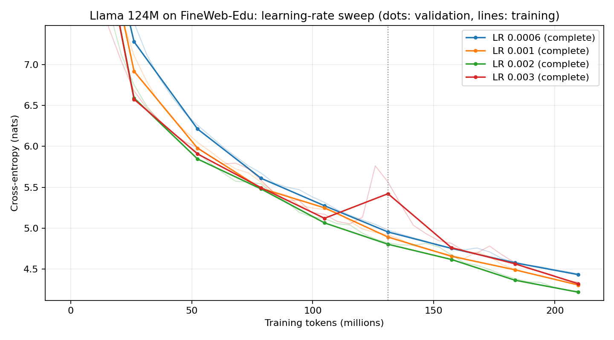

# CS336 Colab

The Colab side of the project: two language models trained from random weights in Google Colab notebooks, each with its saved outputs, metrics and plots.

| Track | Folder | Model | Status |
| --- | --- | --- | --- |
| [TinyStories](#tinystories) | [`TinyStories/`](TinyStories/) | 22.7M-parameter Transformer, Stanford CS336 Assignment 1, on a T4 | **Done.** 327.68M tokens, full-split validation loss **1.4099** |
| [FineWeb-Edu](#fineweb-edu) | [`FineWebEdu/`](FineWebEdu/) | 124.7M-parameter Llama, CMU 11-711 blocks at GPT-2 Small size, bf16 on an L4 | **Stage 1 done.** 3.0B tokens, full-split validation loss **3.126**. Stage 2 (10B tokens) in progress |

```text
CS336_Colab/
├── README.md
│
├── TinyStories/
│   ├── CS336_TinyStories_Training.ipynb          # Original training notebook
│   ├── CS336_TinyStories_Trained.ipynb           # Trained notebook, saved outputs & story generator
│   └── runs/
│       ├── metrics.json
│       └── learning_curves.png
│
└── FineWebEdu/
    ├── CS336_FineWebEdu_Llama124M_LR_Sweep.ipynb         # Token cache, smoke test, probe & LR sweep
    ├── CS336_FineWebEdu_Llama124M_Trained_Stage_1.ipynb  # Full training, Stage 1 results
    └── runs/
        ├── lr_sweep_v1/
        │   ├── sweep_summary.json
        │   └── lr_sweep.png
        │
        └── full_v1/
            ├── run_config.json
            ├── probe-l4.json
            ├── token_cache_manifest.json
            │
            ├── stage1_2.5B/
            │   ├── main_metrics.json
            │   ├── branch_metrics.json
            │   ├── model.json
            │   └── training_curves.png
            │
            └── stage2_10B/                      # After Stage 2
```

## TinyStories

This track follows Stanford CS336 Assignment 1. We trained a byte-level BPE tokenizer and a 22.7M-parameter Transformer from random weights on TinyStories using a Google Colab T4.

- [Trained notebook with saved outputs](TinyStories/CS336_TinyStories_Trained.ipynb) · [Open in Colab](https://colab.research.google.com/github/xqzr2000/Stanford-CS336-Llama-Adaptation/blob/main/CS336_Colab/TinyStories/CS336_TinyStories_Trained.ipynb)
- [Original training notebook](TinyStories/CS336_TinyStories_Training.ipynb)

### Training results

Each sweep run processed 40.96 million tokens. Of the five peak learning rates tested, `3e-3` gave the lowest full-split validation loss. We used that rate for a fresh full-budget run.

| Run | Peak LR | Tokens processed | Sampled validation loss | Full-split validation loss |
| --- | ---: | ---: | ---: | ---: |
| 40M sweep | `3e-4` | 40.96M | 1.9418 | 1.8831 |
| 40M sweep | `1e-3` | 40.96M | 1.7303 | 1.6774 |
| 40M sweep | `3e-3` | 40.96M | 1.7035 | 1.6544 |
| 40M sweep | `5e-3` | 40.96M | 1.8117 | 1.7569 |
| 40M sweep | `7e-3` | 40.96M | 1.8797 | 1.8271 |
| Full run | `3e-3` | **327.68M** | **1.4466** | **1.4099** |

The full run finished 40,000 optimizer steps with a full-split perplexity of **4.10**. The orange line in the plot shows cross-entropy on the same 512 held-out windows at each evaluation. It ends just below the CS336 handout's 1.45 reference. The full-split score comes from a separate evaluation at the end of training.


The [run metrics](TinyStories/runs/metrics.json) include the configuration and complete loss history. [Download `model.pt`](https://github.com/xqzr2000/Stanford-CS336-Llama-Adaptation/releases/download/tinystories-v1/model.pt) from the [`tinystories-v1` release](https://github.com/xqzr2000/Stanford-CS336-Llama-Adaptation/releases/tag/tinystories-v1).

### What changed in the generated stories

Both models continued the same prompt about a little robot finding a blue kite at the same peak learning rate of `3e-3`. The sweep sample repeats itself and drifts through a bird, a balloon, and an unexplained angel. The full-run sample keeps the robot and the girl at the center of the story and follows a clear sequence where she loses her kite, the robot retrieves it from a tree, and they become friends. It still has a local continuity slip when the robot takes a kite before going to look for it.

See Section 12 of the [trained notebook](TinyStories/CS336_TinyStories_Trained.ipynb) for both stories and the side-by-side analysis. The comparison uses the 40.96M-token sweep checkpoint and the 327.68M-token full-run checkpoint.

### Model and training settings

| Setting | Value |
| --- | --- |
| Architecture | Pre-norm decoder with RMSNorm, RoPE, causal multi-head attention, and SwiGLU |
| Size | 22,696,448 parameters, 4 layers, width 512, 16 heads, feed-forward width 1,344, untied embeddings |
| Tokenizer | 10,000-entry byte-level BPE trained on the TinyStoriesV2-GPT4 training split |
| Context and batch | 256 tokens, 32 sequences per optimizer step |
| Optimizer | AdamW with β = (0.9, 0.95), weight decay 0.1, and gradient clipping at 1.0 |
| Schedule | 5% linear warmup, then cosine decay to 10% of the peak learning rate |
| T4 precision | FP16 autocast with gradient scaling, with FP32 training weights and optimizer state |

The notebook includes a hand-written attention implementation. `FAST_ATTENTION = True` uses PyTorch's fused attention for training, and the notebook checks that both implementations produce the same output.

### Generate stories in Colab

1. [Open the trained notebook in Colab](https://colab.research.google.com/github/xqzr2000/Stanford-CS336-Llama-Adaptation/blob/main/CS336_Colab/TinyStories/CS336_TinyStories_Trained.ipynb). A CPU runtime is enough.
2. In Section 1, set `MODE = "generate"` and `GENERATE_FROM = "github"`.
3. Select **Runtime → Run all**. Section 10 downloads the released weights and prints a story. This mode skips Drive mounting, data preparation, and training.
4. Change `PROMPT` in Section 10 and rerun that cell to try your own opening.

To use a manually downloaded copy, upload it through Colab's Files sidebar and set `GENERATE_FROM = "local"` and `LOCAL_MODEL_PATH = Path("/content/model.pt")`, adjusting the path to match your upload.

If you have the export in Drive at `MyDrive/CS336_TinyStories/runs/full-lr3e-03/model.pt`, use `MODE = "generate"`, `GENERATE_FROM = "drive"`, `PROFILE = "full"`, and `PEAK_LR = 3e-3`.

### Reproduce the full run on a T4

1. Open the trained notebook in Colab and select **Runtime → Change runtime type → T4 GPU**.
2. Use `MODE = "train"`, `PROFILE = "full"`, and `PEAK_LR = 3e-3`. Run from the top and mount Drive when prompted. The first session prepares the tokenizer and token files, which later sessions reuse.
3. After a disconnect, run from the top again with the same settings. The training loop saves a checkpoint about once an hour and keeps the newest two. It tries the older checkpoint if the newest one is unreadable.

The final model export contains FP16 weights, the architecture configuration, the tokenizer, and validation results. Resuming training requires the Drive checkpoints, which also store the optimizer and training state.

The run writes its checkpoints, export, metrics, and plot to `MyDrive/CS336_TinyStories/runs/full-lr3e-03/`. The shared tokenizer and encoded splits live under `MyDrive/CS336_TinyStories/data/`. Allow about 3 GB of free Drive space.

## FineWeb-Edu

This track trains the 124,668,672-parameter Llama of [Track 2](../README.md#3-track-2-a-124m-llama-on-fineweb-edu) from random weights on [FineWeb-Edu](https://huggingface.co/datasets/HuggingFaceFW/fineweb-edu) `sample/10BT`. It uses CMU 11-711 Llama 2 blocks at GPT-2 Small's depth and width, a 32,000-entry BPE tokenizer trained on FineWeb-Edu, and bf16 on a Colab L4. It runs in two notebooks:

- [LR sweep notebook](FineWebEdu/CS336_FineWebEdu_Llama124M_LR_Sweep.ipynb): builds the first token cache, runs the smoke test and probe, and sweeps the peak learning rate.
- [Stage 1 trained notebook](FineWebEdu/CS336_FineWebEdu_Llama124M_Trained_Stage_1.ipynb): the full-training notebook with its saved output up to the end of Stage 1. It also explains the compute math (parameters, tokens, FLOPs, MFU) and the warmup–stable–decay schedule, with this run's numbers.

### Why an L4

The plan was a Colab A100 40 GB, but Colab assigned an L4 in every session. The L4 uses about 1.7 compute units per hour against the A100's 5.4, so **the cost per token is about the same, but training takes 3–4 times longer**:

| | A100 40 GB (planned) | L4 (used) |
| --- | ---: | ---: |
| Speed | ~130–150k tokens/s (expected) | **40,350 tokens/s** (measured, 24% MFU) |
| Stage 1 (3.0B tokens) | ~6 h | **20.9 h** |
| The whole plan (10.5B tokens) | ~21 h | ~72 h |
| Compute units for the whole plan | ~110–120 | ~120 |

The L4's memory bandwidth (300 GB/s) is a fifth of the A100's, and a 124M model is small enough to be limited by bandwidth more than by compute. Its bf16 numerics are the same as the A100's, so the learning rate the sweep picked carries over unchanged. The notebook checkpoints to Drive every hour and resumes on whichever GPU the next session gets, so the slower GPU costs patience, not results.

### LR sweep

Four peak learning rates for 400 steps each (210M tokens) on the L4, with the final run's exact setup: 250 warmup steps, then a constant learning rate, as in WSD's stable phase.

| Peak LR | Validation loss at step 400 | Largest rise in loss after warmup |
| ---: | ---: | ---: |
| 6e-4 | 4.434 | 0.02 |
| 1e-3 | 4.307 | 0.08 |
| **2e-3** | **4.220** | 0.02 |
| 3e-3 | 4.323 | 0.24 (spiked as warmup ended) |

`2e-3` was lowest at every evaluation after warmup and stable. `3e-3` spiked as its learning rate approached its peak, so the stability edge lies between the two.



Details are in [`sweep_summary.json`](FineWebEdu/runs/lr_sweep_v1/sweep_summary.json).

### Stage 1: 2.5B tokens

The full run uses a warmup–stable–decay schedule. It warms up over 250 steps, holds the learning rate at 2e-3, and at step 4,768 (2.5B tokens, about Chinchilla-optimal for 124M) keeps a permanent copy of the checkpoint. A branch from that checkpoint then decays the learning rate linearly to zero over 954 steps (0.5B tokens). The end of that branch is the **Stage 1 model**. The main run continues from the same checkpoint at 2e-3 for Stage 2.

| Milestone | Tokens | Validation loss (512 windows) | Full split (10.3M tokens) |
| --- | ---: | ---: | ---: |
| Step 400 (the sweep's 2e-3 run: 4.220) | 0.21B | 4.260 | — |
| Step 4,768, before the decay | 2.50B | 3.274 | — |
| **Step 5,722, the Stage 1 model** | **3.00B** | **3.136** | **3.126** |


- **The decay works as WSD predicts.** Over the branch, validation loss fell by 0.138 nats. At step 5,000, on the same data, the decaying branch was at 3.242 and the stable run at 3.269.
- **Healthy training.** No loss-spike rollbacks. Near the end of warmup (steps 220–240) the gradient norm reached 11.6 and the loss rose about 0.4, the same spot where 3e-3 spiked in the sweep. It recovered by step 300. After step 400 the largest gradient norm was 0.33 and no step was clipped.
- **The early losses reproduce the sweep**, for example 6.596 at step 50 (sweep 6.591) and 4.628 at step 300 (sweep 4.619), on different batches.
- **Speed.** A median of 40,350 tokens/s at 24% MFU: 20.7 hours of training and 20.9 hours wall-clock. Extending the token cache to all 9.8B training tokens took 1 hour 40 minutes.

The Stage 1 model continues three prompts like this (temperature 0.8, top-p 0.9). It writes fluent, on-topic prose with confident factual errors:

> **The water cycle begins when** there is enough water in the sky to support life. Once it reaches its liquid form, the water is called water vapor. The water vapor is a result of the condensation of water vapor from the atmosphere. …
>
> **In mathematics, a prime number is** a prime number that has the same square root of zero as the other prime numbers. …
>
> **The French Revolution began** when the French Revolution was declared in 1789, and the United States was the first nation to ratify it. …

The [model card](FineWebEdu/runs/full_v1/stage1_2.5B/model.json) has the full samples. The [main run](FineWebEdu/runs/full_v1/stage1_2.5B/main_metrics.json) and [branch](FineWebEdu/runs/full_v1/stage1_2.5B/branch_metrics.json) metrics hold every logged loss, learning rate, gradient norm and speed. The weights stay on Drive for now: after Stage 2, both models get a GitHub release and a side-by-side comparison of their generated text, as in the TinyStories track.

### Stage 2: to 10B tokens (in progress)

The main run continues from step 4,768 at 2e-3. The final decay runs from step 15,258 to 19,073 (8.0B to 10.0B tokens). That's 7.5B more tokens, about 52 hours on the L4, in sessions of about 10 hours. Its record will be `CS336_FineWebEdu_Llama124M_Trained_Stage_2.ipynb`, with its files in `runs/full_v1/stage2_10B/`.

### Run the notebooks

1. **Token cache, on a CPU runtime.** Run the [LR sweep notebook](FineWebEdu/CS336_FineWebEdu_Llama124M_LR_Sweep.ipynb) once to build the first cache and tokenizer. Then **Run all** the training notebook on a CPU runtime to extend the cache to all of `sample/10BT`. It's resumable file by file.
2. **Training, on an A100 or L4.** Select **Run all** in the training notebook. To stop, select **Runtime → Interrupt execution**: it finishes the current step and saves a checkpoint. To continue later, **Run all** again with the same `RUN_NAME`. The Stage 1 notebook's introduction has the details.

Everything lives in `MyDrive/CS336_FineWebEdu_Llama124M/`: the token caches (about 21 GB), the run's metrics, the rolling and pre-decay checkpoints (1.4 GB each) and the exported FP16 models (0.23 GB each).
