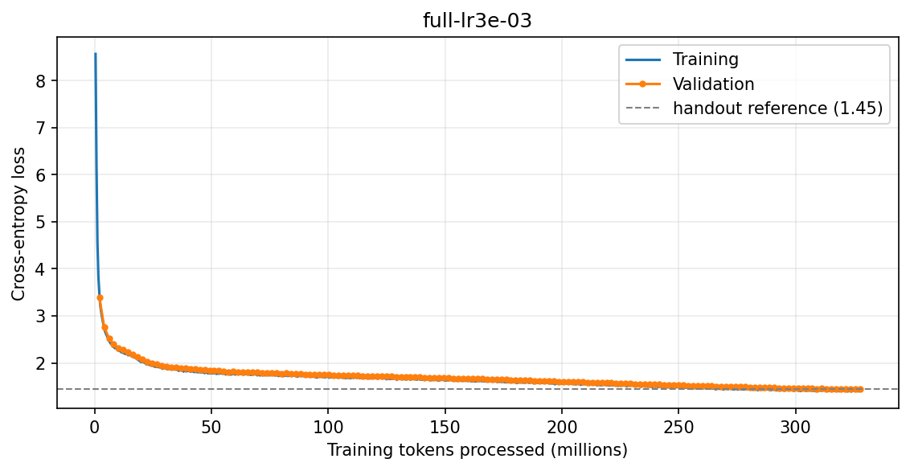

# CS336 Colab

This is the completed Stanford CS336 Assignment 1 track of the project. We trained a byte-level BPE tokenizer and a 22.7M-parameter Transformer from random weights on TinyStories using a Google Colab T4. The separate [Modal track](../docs/Plan.md) is set up to train a 124M-parameter Llama-style model on FineWeb-Edu.

- [Trained notebook with saved outputs](CS336_TinyStories_Trained.ipynb) · [Open in Colab](https://colab.research.google.com/github/xqzr2000/Stanford-CS336-Llama-Adaptation/blob/main/CS336_Colab/CS336_TinyStories_Trained.ipynb)
- [Original training notebook](CS336_TinyStories_Training.ipynb)

## Training results

Each sweep run processed 40.96 million tokens. Of the five peak learning rates tested, `3e-3` gave the lowest full-split validation loss. We used that rate for a fresh full-budget run.

| Run | Peak LR | Tokens processed | Sampled validation loss | Full-split validation loss |
| --- | ---: | ---: | ---: | ---: |
| 40M sweep | `3e-4` | 40.96M | 1.9418 | 1.8831 |
| 40M sweep | `1e-3` | 40.96M | 1.7303 | 1.6774 |
| 40M sweep | `3e-3` | 40.96M | 1.7035 | 1.6544 |
| 40M sweep | `5e-3` | 40.96M | 1.8117 | 1.7569 |
| 40M sweep | `7e-3` | 40.96M | 1.8797 | 1.8271 |
| Full run | `3e-3` | **327.68M** | **1.4466** | **1.4099** |

The full run finished 40,000 optimizer steps with a full-split perplexity of **4.10**. The orange line in the plot shows cross-entropy on the same 512 held-out windows at each evaluation. It ends just below the CS336 handout's 1.45 reference. The full-split score comes from a separate evaluation at the end of training.

The [run metrics](runs/metrics.json) include the configuration and complete loss history. [Download `model.pt`](https://github.com/xqzr2000/Stanford-CS336-Llama-Adaptation/releases/download/tinystories-v1/model.pt) from the [`tinystories-v1` release](https://github.com/xqzr2000/Stanford-CS336-Llama-Adaptation/releases/tag/tinystories-v1).

## What changed in the generated stories

Both models continued the same prompt about a little robot finding a blue kite at the same peak learning rate of `3e-3`. The sweep sample repeats itself and drifts through a bird, a balloon, and an unexplained angel. The full-run sample keeps the robot and the girl at the center of the story and follows a clear sequence where she loses her kite, the robot retrieves it from a tree, and they become friends. It still has a local continuity slip when the robot takes a kite before going to look for it.

See Section 12 of the [trained notebook](CS336_TinyStories_Trained.ipynb) for both stories and the side-by-side analysis. The comparison uses the 40.96M-token sweep checkpoint and the 327.68M-token full-run checkpoint.

## Model and training settings

| Setting | Value |
| --- | --- |
| Architecture | Pre-norm decoder with RMSNorm, RoPE, causal multi-head attention, and SwiGLU |
| Size | 22,696,448 parameters, 4 layers, width 512, 16 heads, feed-forward width 1,344, untied embeddings |
| Tokenizer | 10,000-entry byte-level BPE trained on the TinyStoriesV2-GPT4 training split |
| Context and batch | 256 tokens, 32 sequences per optimizer step |
| Optimizer | AdamW with β = (0.9, 0.95), weight decay 0.1, and gradient clipping at 1.0 |
| Schedule | 5% linear warmup, then cosine decay to 10% of the peak learning rate |
| T4 precision | FP16 autocast with gradient scaling, with FP32 training weights and optimizer state |

The notebook includes a hand-written attention implementation. `FAST_ATTENTION = True` uses PyTorch's fused attention for training, and the notebook checks that both implementations produce the same output.

## Generate stories in Colab

1. [Open the trained notebook in Colab](https://colab.research.google.com/github/xqzr2000/Stanford-CS336-Llama-Adaptation/blob/main/CS336_Colab/CS336_TinyStories_Trained.ipynb). A CPU runtime is enough.
2. In Section 1, set `MODE = "generate"` and `GENERATE_FROM = "github"`.
3. Select **Runtime → Run all**. Section 10 downloads the released weights and prints a story. This mode skips Drive mounting, data preparation, and training.
4. Change `PROMPT` in Section 10 and rerun that cell to try your own opening.

To use a manually downloaded copy, upload it through Colab's Files sidebar and set `GENERATE_FROM = "local"` and `LOCAL_MODEL_PATH = Path("/content/model.pt")`, adjusting the path to match your upload.

If you have the export in Drive at `MyDrive/CS336_TinyStories/runs/full-lr3e-03/model.pt`, use `MODE = "generate"`, `GENERATE_FROM = "drive"`, `PROFILE = "full"`, and `PEAK_LR = 3e-3`.

## Reproduce the full run on a T4

1. Open the trained notebook in Colab and select **Runtime → Change runtime type → T4 GPU**.
2. Use `MODE = "train"`, `PROFILE = "full"`, and `PEAK_LR = 3e-3`. Run from the top and mount Drive when prompted. The first session prepares the tokenizer and token files, which later sessions reuse.
3. After a disconnect, run from the top again with the same settings. The training loop saves a checkpoint about once an hour and keeps the newest two. It tries the older checkpoint if the newest one is unreadable.

The final model export contains FP16 weights, the architecture configuration, the tokenizer, and validation results. Resuming training requires the Drive checkpoints, which also store the optimizer and training state.

The run writes its checkpoints, export, metrics, and plot to `MyDrive/CS336_TinyStories/runs/full-lr3e-03/`. The shared tokenizer and encoded splits live under `MyDrive/CS336_TinyStories/data/`. Allow about 3 GB of free Drive space.
