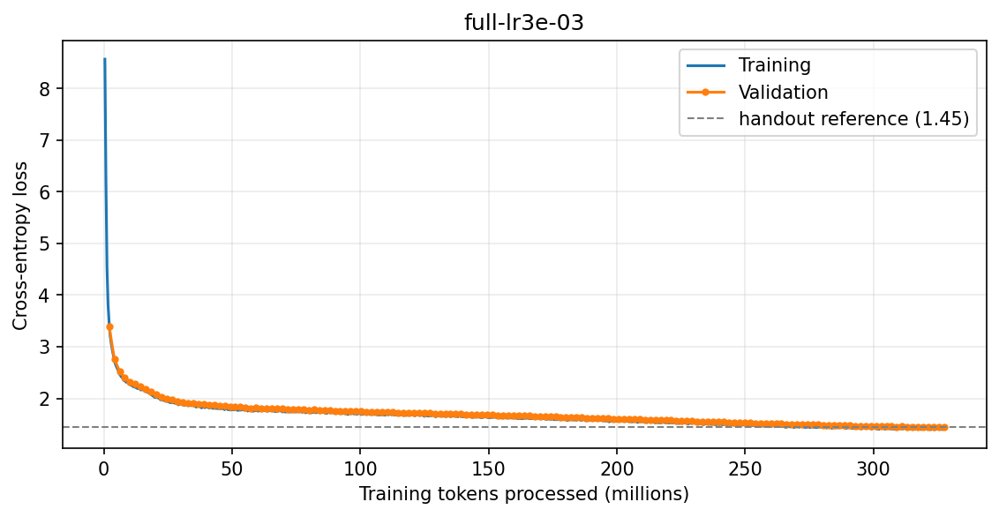
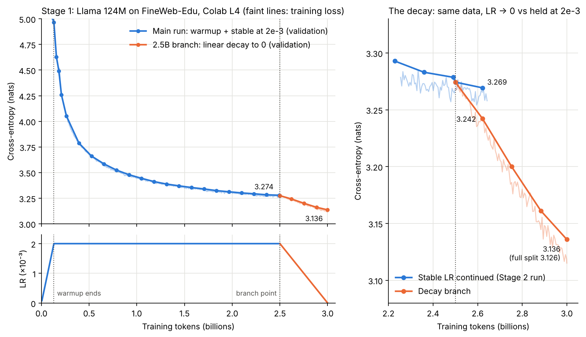

# Stanford CS336 Llama Adaptation

**Learning to train language models from scratch—starting with small Colab experiments, then applying those lessons to a GPT-2 XL-level milestone.**

This repository documents my hands-on study of [Stanford CS336: Language Modeling from Scratch](https://cs336.stanford.edu/) and [CMU 11-711: Advanced NLP](https://cmu-l3.github.io/anlp-fall2025/). Rather than only reading about tokenizers, Transformers, and optimization, I wanted to implement the pieces, train real models, examine their outputs, and learn what breaks when an experiment grows.

The work progresses through three tracks: **22.7M parameters on TinyStories → 124.7M parameters on FineWeb-Edu → a planned ~1–1.4B-parameter model targeting GPT-2 XL's benchmark score.** This is a learning and engineering portfolio, not an official reproduction of either course or of OpenAI's original GPT-2 training run.

## Progress at a glance

| Track | Model and data | Verified result or target | Status |
| --- | --- | --- | --- |
| **1. Learn the fundamentals** | 22.7M-parameter Transformer · TinyStories · Colab T4 | **327.68M training tokens; 1.4099 full-split validation loss** (perplexity 4.10) | **Completed** · [results](CS336_Colab/README.md#tinystories) · [model release](https://github.com/xqzr2000/Stanford-CS336-Llama-Adaptation/releases/tag/tinystories-v1) |
| **2. Practice at GPT-2 Small scale** | 124.7M-parameter Llama-style model · FineWeb-Edu · Colab L4 | **Stage 1: 3.0B training tokens; 3.126 full-split validation loss.** Stage 2 targets **10B tokens total**. | **Stage 1 completed; Stage 2 in progress** · [results](CS336_Colab/README.md#fineweb-edu) |
| **3. Apply the lessons at a larger scale** | Modern ~1–1.4B-parameter model · multi-GPU training on Modal | **Target:** DCLM CORE ≥ **0.256525**, the published GPT-2 XL reference score | **Planned, not trained** · [project plan](docs/Plan.md) |

*Validation losses across Tracks 1 and 2 are not directly comparable: the datasets and tokenizers differ. The Track 3 score is a benchmark target, not an achieved result.*

## 1. Starting small: build and train a 22.7M Transformer

My first goal was to understand the complete pretraining loop using something small enough to run and debug on a Google Colab T4. Inspired by **Stanford CS336 Assignment 1**, I trained a decoder-only Transformer **from random weights**, including a byte-level BPE tokenizer rather than relying on an existing model checkpoint.

The model has **22,696,448 parameters** (4 layers, width 512), a **10,000-token vocabulary**, and a 256-token context window. Its blocks use RMSNorm, RoPE, causal attention, and SwiGLU. Training uses AdamW, learning-rate warmup and decay, and FP16 mixed precision with gradient scaling on the T4.

| Experiment | Training tokens | Full-split validation loss |
| --- | ---: | ---: |
| Best run in the five-rate learning-rate sweep (`3e-3`) | 40.96M | 1.6544 |
| Full training run (`3e-3`, 40,000 steps) | **327.68M** | **1.4099** |

The longer run generated a noticeably more coherent TinyStories example than the shorter sweep checkpoint, although its stories still contain continuity mistakes. That made the training process tangible: lower held-out loss was accompanied by an observable improvement in the sampled text, without making the model reliable.

**What I learned:** implement and check the model and tokenizer; measure the effect of a learning-rate sweep; distinguish sampled loss from full-split evaluation; save tokenized data for reuse; and make checkpoints resumable when Colab sessions end.



**Explore:** [trained notebook and story generator](CS336_Colab/TinyStories/CS336_TinyStories_Trained.ipynb) · [original training notebook](CS336_Colab/TinyStories/CS336_TinyStories_Training.ipynb) · [metrics](CS336_Colab/TinyStories/runs/metrics.json) · [download the released weights](https://github.com/xqzr2000/Stanford-CS336-Llama-Adaptation/releases/tag/tinystories-v1)

## 2. Practicing at 124M: a Llama-style model on FineWeb-Edu

The next step was to move beyond simple stories to educational web text and learn from **CMU 11-711's “Build Your Own Llama”** assignment. I adapted the Llama-style building blocks to **GPT-2 Small's approximate parameter scale**, while keeping the implementation and tokenizer specific to this project. This is **not** a GPT-2 Small architecture reproduction.

The model has **124,668,672 parameters**, 12 layers, width 768, grouped-query attention (12 query heads and 4 key/value heads), RoPE, RMSNorm, SwiGLU, a 32,000-token BPE vocabulary trained on FineWeb-Edu, and a 1,024-token context. It is pretrained from random weights on [FineWeb-Edu](https://huggingface.co/datasets/HuggingFaceFW/fineweb-edu), using a held-out portion for validation.

I first built a reusable token cache, ran a smoke test and GPU memory/throughput probe, and tested four learning rates on a Colab L4. The sweep selected **`2e-3`** based on validation loss and stability. The full run uses bf16, gradient accumulation, and a **warmup–stable–decay (WSD)** schedule, with hourly checkpointing so training can resume across Colab sessions.

### Results so far

| Milestone | Tokens seen by that model | Result | Status |
| --- | ---: | --- | --- |
| Learning-rate sweep | 210M per candidate run | `2e-3` selected; validation loss **4.220** at step 400 | **Completed** |
| Stage 1: 2.5B-token checkpoint + 0.5B-token decay branch | **3.0B** | Full-split validation loss **3.126**; completed in **20.9 hours** on an L4 | **Completed** |
| Stage 2: continue the main run from the **2.5B pre-decay checkpoint** | **10B total (target)** | Final training and evaluation results not yet recorded in this README | **In progress** |

The Stage 1 model produces more fluent, on-topic educational prose, but its generated explanations still include obvious factual errors. That is an important part of the result: fluent text is not the same as dependable knowledge.

**What I learned:** adapt a model architecture instead of only scaling the parameter count; tokenize and validate billions of tokens consistently; use bf16-capable hardware to avoid FP16's range limits at high learning rates; select training settings with measured throughput and validation loss; and design a training schedule that supports branching, comparison, and recovery.



**Explore:** [learning-rate sweep notebook](CS336_Colab/FineWebEdu/CS336_FineWebEdu_Llama124M_LR_Sweep.ipynb) · [Stage 1 trained notebook](CS336_Colab/FineWebEdu/CS336_FineWebEdu_Llama124M_Trained_Stage_1.ipynb) · [sweep metrics](CS336_Colab/FineWebEdu/runs/lr_sweep_v1/sweep_summary.json) · [Stage 1 run metrics](CS336_Colab/FineWebEdu/runs/full_v1/stage1_2.5B/branch_metrics.json) · [full Colab guide](CS336_Colab/README.md#fineweb-edu)

## 3. Why GPT-2 XL is my next milestone

[GPT-2 XL](https://openai.com/index/gpt-2-1-5b-release/), the roughly **1.5-billion-parameter** model OpenAI released in **November 2019**, feels like a meaningful milestone to aim for. Its [paper](https://cdn.openai.com/better-language-models/language_models_are_unsupervised_multitask_learners.pdf) showed that a model trained only to **predict the next token** of web text starts doing tasks it was never trained for: answering questions, translating, summarizing. If you add "TL;DR:" after a news article, the model will continue with a summary, because that pattern appears all over the web. The results were rough, but they improved steadily as the models grew, and the 1.5B model was the largest and best of the family. It was an early glimpse of what researchers would call [emergent abilities](https://arxiv.org/abs/2206.07682) in 2022, and the seed from which GPT-3 and today's assistants grew.

That November date was the end of a staged rollout. OpenAI released GPT-2 over the course of 2019, citing concerns about potential misuse: the smallest model (124M parameters) came out with the paper in February, the 355M model followed in May, and the 774M model in August. The full 1.5B model arrived last, when OpenAI reported it had seen "no strong evidence of misuse so far." It's worth being precise about what that history shows: the misuse concern wasn't about the 1.5B model alone. Every model above 124M was initially withheld, and each was released only after OpenAI had watched the previous one for abuse. The 1.5B model simply sat at the top of that ladder, and was held back the longest (nine months), because its text was the most convincing.

That ladder is exactly why I'm taking my shot at the GPT-2 family. These are the models OpenAI considered capable enough to meter out one rung at a time, and they're also the last generation small enough for one person to train. The next step up was the 175-billion-parameter GPT-3. Having already trained a 124M-parameter Llama-style model on a single L4, I'm planning a roughly 1.5B-parameter run on 8 H100 GPUs. My interest is practical: **how much of that 1.5B-level performance can one person reproduce today with modern training techniques and a tightly controlled compute budget?**

Training at this scale is still *dangerous to my wallet*. After already paying for H100 time in another course project, I know how quickly a training experiment can become an expensive lesson. But with today's open tools, GPU rentals, and more efficient recipes, a **GPT-2 XL–level target** is at least something I can plan toward, test in stages, and potentially reach on my own.

The key distinction is that **model size is not model capability**. Parameter count describes how many learned weights a model has, but results also depend on the **number of tokens used in training**, the data's quality and diversity, architecture, optimization, and evaluation. A ~1.5B model trained on about 10B tokens should not be assumed to behave like a similarly sized model trained on trillions. For context, [Meta reports up to 9T pretraining tokens for Llama 3.2 1B](https://huggingface.co/meta-llama/Llama-3.2-1B)—far beyond this project's planned token budget. Research on [compute-optimal language model training](https://arxiv.org/abs/2203.15556) also shows why the balance between model size and training data matters.

Today's capable 1–2B models are about GPT-2 XL's size, but trained on roughly a thousand times more tokens than a GPT-2-level run:

| Model | Year | Parameters | Training tokens | Tokens per parameter | Training cost |
| --- | --- | ---: | ---: | ---: | ---: |
| GPT-2 XL (OpenAI) | 2019 | 1.5B | not published | — | ~USD 43,000 ([estimate](https://github.com/karpathy/nanochat)) |
| GPT-2 XL reproduction, [llm.c](https://github.com/karpathy/llm.c/discussions/677) | 2024 | 1.6B | 32B | ~20 | USD 672 |
| [nanochat](https://github.com/karpathy/nanochat), GPT-2 XL-level | 2026 | ~1–1.4B | ~7–15B | ~8–10.5 | ~USD 48 (2 h on 8×H100 at USD 3/GPU-hour) |
| **This project, Track 3 (planned)** | 2026–27 | ~1–1.4B | ~8–15B | ~8–10.5 | **USD 180–290** (all phases, on Modal) |
| Llama 3.2 1B (Meta) | 2024 | 1.2B | 9T | ~7,300 | — |
| Qwen2.5-1.5B (Alibaba) | 2024 | 1.5B | 18T | ~12,000 | — |
| SmolLM2-1.7B (Hugging Face) | 2025 | 1.7B | 11T | ~6,500 | ~USD 250,000 |

Token counts for Qwen2.5 and SmolLM2, and SmolLM2's cost, are from the [SmolLM2 paper](https://arxiv.org/abs/2502.02737); Llama 3.2's is from Meta's model card. The gap to the bottom rows is mostly training data and compute, not the architecture.

So I am **not claiming that reaching ~1–1.4B parameters produces today's small-model abilities**, or that matching one benchmark recreates GPT-2 XL in every respect. The project will report **parameters, training tokens, evaluation results, and actual compute spending** together.

### Track 3: the modern update (planned)

Rather than reproduce GPT-2 XL's 2019 architecture exactly, I plan to write a modern decoder-only trainer, using ideas from [nanochat](https://github.com/karpathy/nanochat) as references and applying what Tracks 1 and 2 taught me.

| Decision | Current plan—not a completed result |
| --- | --- |
| **Goal** | Reach **DCLM CORE ≥ 0.256525**, the GPT-2 XL reference score used in nanochat's [GPT-2 speedrun](https://github.com/karpathy/nanochat/blob/master/dev/LEADERBOARD.md) |
| **Model** | Approximately **1–1.4B parameters**, using a modern recipe rather than GPT-2's original architecture |
| **Training data** | FineWeb-Edu, with approximately **8–15B training tokens** as a provisional budget; finalize after pilot measurements |
| **Implementation** | Write and test the model, tokenizer/data pipeline, optimizer, distributed training, evaluation, and resumable checkpoints |
| **Compute** | One Modal node with **8×H100 GPUs**, subject to availability and measured throughput |
| **Budget** | **USD 180–290 estimated across phases**, *not* a guaranteed price; stop or resize the run if the pilot exceeds the cap |
| **Optional next step** | Supervised fine-tuning into a small chat model; additional post-training only if justified by results and budget |

This benchmark is a **specific evaluation target**, not proof of broad equivalence in language understanding or reasoning. The original GPT-2 checkpoint scored **0.256525** on DCLM CORE in nanochat's evaluation; whether my own model can reach it is an open experiment. **Track 3 code and training results have not been completed yet.**

The work will be divided into spending-gated stages: prepare data, implement and test the distributed trainer, run an inexpensive pilot, rehearse a smaller model, then decide whether the full run is worth the cost. That process is as much a learning objective as the final benchmark score.

**Planning details:** [GPU and budget plan](docs/Plan.md) · [paid-run checklist](docs/Runbook.md) · [Modal infrastructure journal](docs/cloud-walker-Modal.md)

## 4. What this repository demonstrates

Across the completed experiments, the main skills I wanted to practice—and document with evidence—are:

- **Model implementation:** decoder-only Transformers, BPE tokenization, causal attention, RoPE, RMSNorm, SwiGLU, and grouped-query attention.
- **Experimental design:** controlled learning-rate sweeps, held-out validation, saved metrics, model sampling, and comparisons across training budgets.
- **Training systems:** mixed precision, gradient accumulation, GPU memory and throughput probes, reusable token caches, and resumable checkpoints.
- **Reproducibility:** recorded model configurations, tokenizer hashes, dataset manifests, training curves, and saved notebook outputs.
- **Resource decisions:** using Colab T4/L4 where possible, measuring rather than assuming GPU speed, and planning future cloud spending around explicit stop/go checks.

Completed measurements belong to the Colab track; the distributed training, Muon optimizer, CORE evaluation, and larger Modal model are **future work**, not skills I claim to have demonstrated in this repository yet.

## 5. Repository guide

```text
Stanford-CS336-Llama-Adaptation/
├── README.md
├── CS336_Colab/
│   ├── README.md                        # Experiments, plots, results, and Colab instructions
│   ├── TinyStories/                     # 22.7M model: training, trained demo, run metrics
│   └── FineWebEdu/                      # 124.7M model: LR sweep, Stage 1, run metrics
├── docs/
│   ├── Plan.md                          # Future GPT-2 XL-level training plan and budget
│   ├── Runbook.md                       # Checks for paid training runs
│   ├── Learning-Progress.md             # Chronological experiments and troubleshooting
│   └── cloud-walker-Modal.md            # Modal infrastructure and spending lessons
├── .devcontainer/                       # Development environment configuration
├── pyproject.toml                       # Python project dependencies and tooling
└── uv.lock                              # Dependency lockfile
```

**Try a completed model:** open the [TinyStories trained notebook in Colab](https://colab.research.google.com/github/xqzr2000/Stanford-CS336-Llama-Adaptation/blob/main/CS336_Colab/TinyStories/CS336_TinyStories_Trained.ipynb), set `MODE = "generate"` and `GENERATE_FROM = "github"`, then run the notebook. The released model can generate short stories on a CPU runtime without retraining.

For the FineWeb-Edu model, start with the [Colab experiments and reproduction guide](CS336_Colab/README.md#fineweb-edu). The Stage 1 weights are documented as stored on Drive rather than released publicly; the trained notebook includes the recorded results.

## 6. Next steps

1. **Finish the 124.7M Stage 2 run** to 10B total training tokens, publish its results, and compare outputs with the 3B-token Stage 1 model.
2. **Experiment with downstream tasks** using copies of the 124.7M checkpoint: SST-5 sentiment fine-tuning, followed by small-scale SFT and possibly DPO. These are **planned**, not completed results.
3. **Build the Modal multi-GPU pipeline** behind small, testable milestones; measure actual throughput and cost before committing to a ~1–1.4B training run.
4. **Evaluate honestly** against GPT-2 XL's CORE reference, report additional model behavior and limitations, and publish both successes and unsuccessful attempts.

The broader goal is to understand **how a language model is built, trained, evaluated, and operated**, not just to produce a larger checkpoint. This README records the milestones; the notebooks, metrics, and [learning log](docs/Learning-Progress.md) show the work behind them.

## Course materials and references

- [Stanford CS336: Language Modeling from Scratch](https://cs336.stanford.edu/) and [Assignment 1: Basics](https://github.com/stanford-cs336/assignment1-basics) — tokenizer, Transformer, training loop, and evaluation foundations.
- [CMU 11-711: Build Your Own Llama](https://cmu-l3.github.io/anlp-fall2025/assignments/assignment1) — Llama-style architecture and downstream fine-tuning ideas.
- [OpenAI GPT-2 paper (2019)](https://cdn.openai.com/better-language-models/language_models_are_unsupervised_multitask_learners.pdf) and [GPT-2 1.5B release](https://openai.com/index/gpt-2-1-5b-release/) — historical model and release context.
- [Hoffmann et al. (2022), Training Compute-Optimal Large Language Models](https://arxiv.org/abs/2203.15556) — why parameter count and training-token budget must be considered together.
- [Andrej Karpathy's nanochat](https://github.com/karpathy/nanochat) and [GPT-2 benchmark leaderboard](https://github.com/karpathy/nanochat/blob/master/dev/LEADERBOARD.md) — modern training and CORE evaluation references for the planned third track.

This is an independent educational adaptation. The course names and third-party projects are credited as sources of learning and technical reference, not as endorsements of these experiments.
